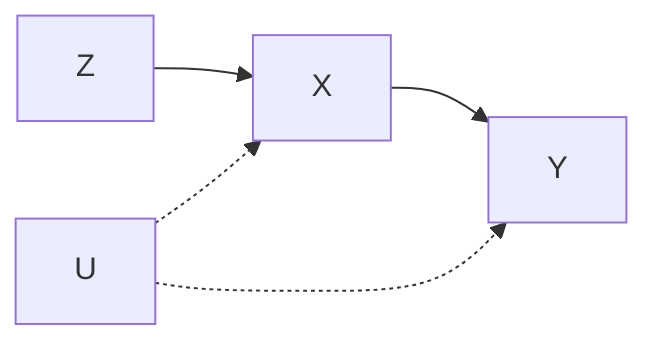

# study skill 设计调研：为做研究理解概念（不是应试）（2026-10-16）

## 0. 结论
- 默认用 **Mermaid**。它在 GitHub、Cursor、Claude Code 生成的 md、Claude.ai、Codex 和 Notion 里都能直接渲染，与具体工具无关。
- 遇到数学直觉，用 **matplotlib 出 PNG/SVG**，在 md 里用 `` 引用。
- 想交互时：在 Claude.ai 网页版或桌面版里用 artifact（HTML、D3 或 p5、SVG、React）；在其他环境里写一个单文件 HTML，用浏览器打开。
- **动画不作默认，只在用户要求时生成**。现在 AI 写 Manim 还不可靠（证据见 §1.2）。
- 教学流程定为：动机 → 直觉 → 图 → 和你已知概念的桥 → 你复述 → 四类诊断 → 在你的联想上纠正，并重画概念图。

## 1. 画图工具
### 1.1 各工具对比（判断依据是能不能在各环境里直接显示）
| 工具 | 适合的图 | Markdown 内能否显示 | 安装成本 | 跨环境 |
|---|---|---|---|---|
| Mermaid（v12，2026-10） | 概念图（flowchart）、推导流程、因果 DAG（flowchart LR）、mindmap、时间线（概念演化）、sequence、Venn、quadrant | 代码块原生渲染 | 0；导出 PNG 用 mermaid-cli | 最好 |
| Graphviz/DOT | 节点多的 DAG、依赖图 | 不能，需先渲染成 SVG/PNG | brew install graphviz | 中 |
| TikZ/LaTeX | 论文级几何图、交换图 | 不能，需先编译成 PDF/SVG | MacTeX 很重 | 低 |
| Excalidraw（我们装有 MCP，官方仓库 github.com/excalidraw/excalidraw-mcp） | 手绘风的直觉草图、白板式讲解 | 需导出 PNG/SVG，或给分享链接 | MCP 已有 | 中 |
| matplotlib/plotly | 几何直觉、分布、收敛、偏差-方差这类数值图 | PNG/SVG 可以显示；plotly 生成 HTML | pip | 好（静态图） |
| Manim CE（v0.22，2026-10-08；v0.21 加入 Typst，可不装 TeX） | 变换过程、推导动画 | 只能输出 mp4/gif | 中（需 ffmpeg，最好有 LaTeX） | 低 |
| D2 | 架构图、分层概念图，比 Mermaid 好看 | 不能，需先渲染 | 单个二进制文件 | 中 |
| PlantUML | UML | 不能，需先渲染 | 需要 Java | 低（用 Mermaid 代替） |
| HTML（D3/p5）或 Claude artifact | 拖参数看变化（如 IV 强弱、正则化路径） | Claude.ai 内联显示；其他环境打开文件 | 0 | 只在 Claude.ai 内联 |

Mermaid 12 的注意点：默认布局改成 ELK，默认主题改成 neo。要用旧样式，需在 front-matter 写 `layout: dagre`。新增了 use-case 和 agentflow-beta 两种图（来源：github.com/mermaid-js/mermaid/releases）。

### 1.2 AI 生成动画的质量证据
- **TheoremExplainAgent**（ACL 2025，github.com/TIGER-AI-Lab/TheoremExplainAgent）：在 240 个定理上测试，完整生成视频的成功率分别是 o3-mini 93.8%、GPT-4o 55%、Gemini 2.0 Flash 14.6%、Claude 3.5 Sonnet 2.1%。失败的主要原因是幻觉出不存在的 Manim API，其次是 LaTeX 报错。即便生成成功，**大多数视频也有元素重叠、布局问题**（Layout 0.59–0.61，人工视频为 0.73）。
- **Code2Video**（PMLR 2026，github.com/showlab/Code2Video）：用 Planner、Coder、Critic 三个 agent，Critic 用 VLM 看截图来修布局。Layout 提升到 0.88–0.91，比直接生成代码好 40%。代价是流水线重，每段要多轮渲染再加 VLM 检查。
- Generative Manim（github.com/marcelo-earth/generative-manim）是 demo 级项目。Motion Canvas 和 Remotion（TS/React）适合人来精细制作，AI 一次写对的把握同样不大。
- 结论：你对 Manim 的担心有依据。skill 里动画只能是**可选项**，并且必须走「渲染 → 截关键帧自查 → 修」的闭环。一次生成的结果不能直接交给你。日常学习用**静态图加分步图**（同一张 Mermaid 图画 2–3 个版本，逐步添加节点），效果接近动画，可靠性高得多。

### 1.3 默认组合（按图的类型和使用环境）
| 需求 | 默认 | 备选 |
|---|---|---|
| 概念地图、和已知概念的关系 | Mermaid flowchart 或 mindmap | Excalidraw（手绘） |
| 推导链、定理依赖 | Mermaid flowchart TD | Graphviz |
| 因果 DAG | Mermaid flowchart LR（混杂用虚线表示） | Graphviz、dagitty |
| 概念的历史演化 | Mermaid timeline | — |
| 几何或数值直觉 | matplotlib 出 SVG | Claude.ai 里用交互 artifact |
| 过程或变换 | 分步 Mermaid，或 matplotlib 的多个子图 | 用户明确要求才做 Manim，并带截帧自检 |

已核实能打开的现成 skill：anthropics/skills（github.com/anthropics/skills，有 canvas-design 等视觉类 skill，可参考它们的写法）。我们这边已经有 excalidraw MCP。专门的 manim 或 excalidraw Claude skill 还没逐个核实，不推荐依赖。

## 2. 教学法：每条理论落成一条具体规则
1. **为什么先于是什么**（Pólya；历史发生法，Toeplitz）。规则：先讲这个概念之前卡在哪个问题上、旧方法为什么不行，再给定义。例如讲 IV，先讲遗漏变量偏误让 OLS 失效。
2. **从具体到抽象，逐步撤掉支架**（concreteness fading，Fyfe 等 2014）。规则：先给一个最小例子，再给半抽象的表述，最后给形式定义。**找不到贴切的例子就明说「没有好例子」，不硬造。** 判断标准：如果例子还要再解释，它就不贴切。
3. **桥接类比**（Clement 1993）。规则：先问你会联想到什么。从你已知的锚点出发（比如回归、条件期望），如果锚点和新概念差得远，就插一个中间的桥接例子，并明确标出类比在哪里失效。
4. **知识整合**（Linn KI：引出想法 → 加入新想法 → 辨别 → 反思）。规则：把你的已有观点当素材，不当错误清掉。每轮回答都要明说「你的 X 和新概念的 Y 是什么关系」。
5. **概念转变**（Posner 1982：先有不满，新概念要可理解、可信、有用）。规则：要纠正一个误解，先构造一个能让你自己看到原理解出问题的反例，再给出新理解，并说明它为什么能解释这个反例。
6. **Chi 的误解层级**：误解可能是孤立的错误信念，也可能是心智模型有缺陷，或者是本体类别放错了（比如把「过程」当成「东西」）。规则：诊断时先判断是哪一层。前两层改局部即可，第三层要重建框架。
7. **复述评分**（teach-back；参考 feynman-skill「真懂还是记住名词」）。规则：只用术语、换种说法就讲不下去，就判成「名词」。可以让你在一个新情境里用一次这个概念来检验。
8. **数学直觉**（Thurston《On proof and progress》强调理解有多种通道：逻辑、几何、计算、运动；Tao 的三阶段：前严格 → 严格 → 后严格）。规则：同一个概念至少给两条通道，比如一张图加一个计算例子。研究级的目标是后严格阶段：能凭直觉预测结论，再用严格推导核对。
9. **双重编码**（Paivio；Mayer 多媒体原则）。规则：图和文字放在一起、一一对应；图里只放关键关系，不加装饰。

### 复述诊断的四类标签
| 标签 | 定义 | 处理 |
|---|---|---|
| ✅ 核心正确 | 抓住了机制或目的 | 肯定，并指出它对应原文或定义的哪一部分 |
| 🟡 部分正确 | 方向对，但缺条件、边界或适用范围 | 补上条件，用一个反例说明为什么需要这个条件 |
| ❌ 误解 | 和定义矛盾，或因果方向反了 | 用 Posner 的方法：先反例，再新模型；标出属于 Chi 的哪一层 |
| 🔗 缺少连接 | 每一点单独看都对，但没连到动机或已知概念 | 用一条桥接边连上，在概念图上画出来 |

最后给一个大致的「正确比例」（按要点计数，例如 3/5），并说明每个要点怎么判的。不只给一个笼统的分数。

**例子（概念：工具变量）**。用户复述：「IV 就是找一个和 X 相关的变量，替换掉 X 来回归，这样就没有偏了，有点像 2SLS 的第一阶段预测值。」
- ✅「和 X 相关」，即相关性条件。
- 🔗「2SLS 第一阶段」：联想正确，但没说清**为什么**用预测值，也就是只保留 X 中由 Z 驱动的、外生的那部分变异。
- ❌「替换掉 X 就没有偏」：漏掉了排他性和外生性。Z 如果能直接影响 Y，偏误照样存在。属于心智模型缺陷。
- 🟡「没有偏」：IV 是一致的，但有限样本下有偏，弱工具时偏误会很严重。
- 大致比例 2/4。接下来从用户的「第一阶段」联想出发，画 DAG：Z→X→Y，U→X，U→Y；再加一条 Z→Y 的红色虚线，说明违反排他性时会出什么问题。

## 3. 可借鉴的现成做法（链接均已核实能打开）
- **feynman-skill**（github.com/alchaincyf/feynman-skill）：区分真懂和记住名词，检测「货物崇拜」式理解。借它的判定标准，放进 §2 第 7 条。
- **Claude Code 的 Learning 输出风格**：在关键处留 `TODO(human)`，让用户自己写。借来做「推导留空让你补」的可选环节。
- **mordor-forge/study-skill**（github.com/mordor-forge/study-skill）：用 FSRS 安排复习、支持断点续学。你不要考试，所以**只借断点续学和 progress 记录**，复习队列做成可选。
- Claude.ai、ChatGPT 的学习模式：共同的做法是先问用户的水平和目标，给提示而不直接给答案。借「先问你已经知道什么」这一步。

## 4. 交互协议（一个概念一轮）
0. **定位**（1 句话）：你为什么要学它（结合哪个研究点）、已经知道哪些相关概念。用户没说就从 reading/ 和 concepts/ 里推断，只问一个问题。
1. **一句话直觉**：不超过 2 句，不用术语。
2. **动机和来历**：之前卡在哪个问题、旧方法为什么不行、它是怎么从旧想法演化来的。需要时画一张 timeline。
3. **原理和例子**：最小例子 → 一般化 → 形式定义，公式标出处。没有贴切的例子就说明。
4. **图**：默认画一张 Mermaid 概念图，标出新概念和你已知概念的连线；数学概念再加一张 matplotlib 图。
5. **连接**：明确列出 2–3 条「它和你知道的 X 是什么关系（相同在哪、不同在哪、类比在哪里失效）」。
6. **你来复述**：AI 在这里停下，请你用自己的话讲一遍，并说出联想到了什么。这一步**不可跳过**，除非你说「只要笔记」。
7. **诊断**：用四类标签逐条判，给出比例，判断误解属于 Chi 的哪一层。
8. **纠正**：从你自己的联想出发补和改，然后**重画概念图**，用颜色区分你原来的理解、纠正的部分和新增的部分。
9. **追问循环**：你继续问，重复 6–8 步，直到没有 ❌。
10. **落盘**：按下面的模板写入概念笔记。

## 5. 概念笔记模板 `reading/concepts/<prefix>-<slug>.md`
```markdown
---
concept: 工具变量 (Instrumental Variable)
aliases: [IV]
status: 理解中 | 已理解 | 有疑问
related: [[def-ols]], [[thm-2sls]], [[def-confounding]]
sources: [Angrist & Pischke MHE §4.1]
updated: 2026-10-16
---
# 工具变量（IV）
## 一句话直觉
## 动机与来历
（之前的问题 → 旧方法为什么不行 → 它怎么来的；可加 timeline）
## 原理
（例子 → 一般化 → 形式定义；公式标出处）
## 图

## 和已知概念的关系
| 已知概念 | 关系 | 类比在哪里失效 |
## 我的复述与诊断记录
### 第 1 轮（2026-10-16）
> 我的复述：……
- ✅ … / 🟡 … / ❌ …（Chi 层级：心智模型） / 🔗 …
- 大致比例：2/4
- 纠正后的图：……
## 待解决的问题
- [ ] ……
```

## 6. 待和用户确认
1. 诊断时给的「大致比例」，用户想要数字，还是只要四类标签？
2. 交互 HTML 只在 Claude.ai 里用，还是本地也生成 HTML 文件？
3. 动画的门槛：只在用户明确说「做动画」时才用 Manim（带截帧自检），这样可以吗？
