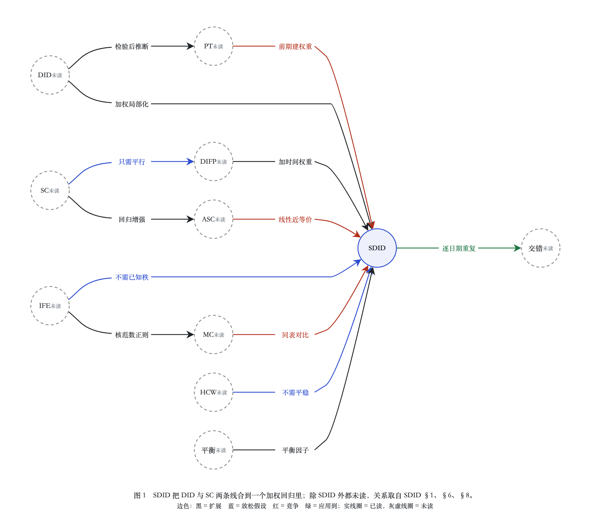

# 文献地图：面板政策评估中的加权 DID 与合成控制

**范围说明（先读）**：读取根目录 `skills/study/evals/reading/`，`index.json` 里只有 1 篇论文（`arXiv:1812.09970`，SDID；记录 seq 1 = quickread，seq 2 = study）。所以这张图上**只有 SDID 是已读**，其余 10 个节点都是「未读」：它们的方法、假设、关系全部转述自 SDID 原文 §1、§6、§8（MinerU precision 转写，全 69 页），不是我们读过原文后的判断。空白点清单因此很薄。生成日期 2026-10-17；deep-research 文献地图模式。

用到的文件：`papers/2026-10-16_arkhangelsky_sdid/` 下的 `quickread.md`、`insights.md`、`reflection.md`、`method.md`；转写稿只读 §1、§6 Related Work、§8 Staggered Adoption 与参考文献。

## 1. 演化图

源文件：[`fig-lit-map.html`](fig-lit-map.html)（study kit `auto-dag-elk` 模板；每条边的动词做成标签节点参与 ELK 布局）。边色：黑 = 扩展，蓝 = 放松假设，红 = 竞争，绿 = 应用到；类型同时写在下面表 E 里，不只靠颜色。

## 2. 节点（表 N）

| 节点 | 作品（照抄 SDID 参考文献） | 状态 | SDID 中出处 | 核验 |
|---|---|---|---|---|
| SDID | Arkhangelsky, Athey, Hirshberg, Imbens, Wager. Synthetic Difference in Differences. arXiv:1812.09970 | 已读 | 卡片 | VERIFIED；已发表版 AER 2021，doi:10.1257/aer.20190159 |
| DID | Ashenfelter & Card. Using the longitudinal structure of earnings to estimate the effect of training programs. REStat 67(4), 1985 | 未读 | §1 | VERIFIED，doi:10.2307/1924810 |
| SC | Abadie, Diamond & Hainmueller. Synthetic control methods for comparative case studies: Estimating the effect of California's tobacco control program. JASA 105(490), 2010 | 未读 | §1, §2.1, §6 | VERIFIED，doi:10.1198/jasa.2009.ap08746 |
| DIFP | Doudchenko & Imbens. Balancing, regression, difference-in-differences and synthetic control methods: A synthesis. NBER, 2016；Ferman & Pinto. Synthetic controls with imperfect pre-treatment fit. arXiv:1911.08521, 2019 | 未读 | §1, §6 | 前者 VERIFIED（doi:10.3386/w22791）；后者 MINOR：已发表为 Quantitative Economics 2021，题名 "pretreatment"，doi:10.3982/qe1596 |
| ASC | Ben-Michael, Feller & Rothstein. The augmented synthetic control method. arXiv:1811.04170, 2018 | 未读 | §6 Eq. 6.1 | MINOR：已发表 JASA 2021，doi:10.1080/01621459.2021.1929245 |
| IFE | Bai. Panel data models with interactive fixed effects. Econometrica 77(4), 2009；Xu. Generalized synthetic control method. Political Analysis 25(1), 2017 | 未读 | §3, §6 | 均 VERIFIED（doi:10.3982/ecta6135；doi:10.1017/pan.2016.2；Bai 条 Crossref 缺作者字段，题名、刊、年一致） |
| MC | Athey, Bayati, Doudchenko, Imbens & Khosravi. Matrix completion methods for causal panel data models. arXiv:1710.10251, 2017 | 未读 | §2.1, §3, §6 | MINOR：已发表 JASA 2021，doi:10.1080/01621459.2021.1891924 |
| HCW | Hsiao, Ching & Wan. A panel data approach for program evaluation ... Hong Kong with mainland China. J. Applied Econometrics 27(5), 2012 | 未读 | §6 Eq. 6.2 | MINOR：Crossref 年份 2011（在线），doi:10.1002/jae.1230 |
| 平衡 | Zubizarreta. Stable weights that balance covariates for estimation with incomplete outcome data. JASA 110(511), 2015（§6 列的平衡方法之一，作代表） | 未读 | §6 | VERIFIED，doi:10.1080/01621459.2015.1023805；§6 其余平衡文献本次未核，不上图 |
| PT | Roth. Pre-test with caution, 2018；Rambachan & Roth. An honest approach to parallel trends, 2019 | 未读 | §6 | 均 MINOR：分别发表为 AER: Insights 2022 "Pretest with Caution"（doi:10.1257/aeri.20210236）与 REStud 2023 "A More Credible Approach to Parallel Trends"（doi:10.1093/restud/rdad018） |
| 交错 | Ben-Michael, Feller & Rothstein. Synthetic controls and weighted event studies with staggered adoption. arXiv:1912.03290, 2019；Athey & Imbens 2021 | 未读 | §8 | 前者 MINOR：NBER 2021 题名 "Synthetic Controls with Staggered Adoption"，doi:10.3386/w28886；Athey & Imbens 本次未核 |

核验方法：Crossref `query.bibliographic` 与 DOI 查询，2026-10-17（deep-research `citation-protocol.md` 两步法的第一步；第二步引述准确性只对 SDID 做过，其余节点的描述都标明是 SDID 的转述）。

## 3. 关系（表 E）

| 从 → 到 | 类型 | 图上动词 | 依据（SDID 原文） | 轴 |
|---|---|---|---|---|
| DID → SDID | 扩展 | 加权局部化 | §1 Eq. 1.1 vs 1.2：同一 TWFE 回归加单位与时间权重；卡片 insights §1 | 方法 |
| SC → DIFP | 放松假设 | 只需平行 | §1：去处理前均值后再做 SC，等于给权重加截距，不再要求完全重合 | 假设 |
| DIFP → SDID | 扩展 | 加时间权重 | §1：DIFP 用来分离固定效应与时间权重各自的作用；reflection 表 | 方法 |
| SC → ASC | 扩展 | 回归增强 | §6 Eq. 6.1：SC 权重加结果回归调整 | 方法 |
| ASC ↔ SDID | 竞争 | 线性近等价 | §6：线性 m(·) 且 ω 不带截距时两者等价 | 方法 |
| IFE → MC | 扩展 | 核范数正则 | §6：用数据驱动正则替代固定秩约束 | 方法 |
| IFE → SDID | 放松假设 | 不需已知秩 | §6：最小二乘法需已知秩与奇异值分离；SDID 不需要 | 假设 |
| MC ↔ SDID | 竞争 | 同表对比 | Table 1–3 同表比较（卡片 §5） | 问题 |
| HCW → SDID | 放松假设 | 不需平稳 | §6：HCW 一线需 L、E 平稳；SDID 不假设平稳 | 假设 |
| 平衡 → SDID | 扩展 | 平衡因子 | §6：平衡对象从可观测协变量换成不可观测因子 | 方法 |
| DID → PT | 扩展 | 检验后推断 | §6：先看平行趋势再推断的有效性 | 问题 |
| PT ↔ SDID | 竞争 | 前期建权重 | §6：前期数据不只用来检验平行，还用来构造权重使之平行 | 问题 |
| SDID → 交错 | 应用到 | 逐日期重复 | §8：按采用日期拆成多个 block 样本，分别估计后加权平均 | 问题 |

## 4. 对比表

**表 1：在 SDID 论文自己的两组安慰剂模拟（baseline）里，SDID 的 RMSE 都最低，DID 最高；只有 SDID 是已读，其余行的数字是 SDID 论文对这些方法的再实现，不是原作者的结果。**

| 方法 | 关键假设 | 数据 / 设定 | 结果（SDID 论文实现） | 出处 |
|---|---|---|---|---|
| SDID（已读） | 低秩因子 L；分配可依赖 L 不依赖 E；单位间误差独立；信噪比等正则条件 | 加州控烟 1970–2000、38 个对照州；CPS 与 PWT 校准安慰剂 | 估计 −15.6（SE 8.4）；CPS RMSE 0.028；PWT RMSE 0.031 | 卡片 §4–§5；Table 1–3 |
| DID（未读） | 平行趋势，加性单位与时间固定效应 | 常用于处理单位较多的场景 | −27.3（17.7）；0.049；0.197 | §1；Table 1–3（卡片 §5） |
| SC（未读） | 加权对照组与处理组处理前完全重合；无单位固定效应、无时间权重 | 原为单个或少数处理单位 | −19.6（9.9）；0.037；0.038 | §1 Eq. 1.3；Table 1–3 |
| DIFP（未读） | 同 SC，但权重带截距（只需平行）；无正则、无时间权重 | 同上 | −11.1（9.5）；0.032；0.039 | §1, §2.1；Table 1–3 |
| MC（未读） | 低秩 L，核范数正则，插补 Y(0) | 同上 | −20.2（11.5）；0.035；0.058 | §2.1, §3；Table 1–3 |
| IFE 最小二乘（未读） | 秩已知或有上界；非零奇异值远离 0 | 大 N 大 T | 未读，原文未给出 | §6 |
| ASC（未读） | N_tr = 1、T_post = 1；拟合 m(·) 增强 SC | 单处理单位单期 | 未读，原文未给出 | §6 Eq. 6.1 |
| HCW（未读） | L 与 E 随时间平稳（导出 Eq. 6.2 矩条件） | 面板 | 未读，原文未给出 | §6 |

结果列三个数依次为：加州 Table 1 估计（SE）、CPS baseline RMSE（Table 2）、PWT Democracy RMSE（Table 3）。

## 5. 空白点（candidate）

门槛：至少 2 张已读卡片独立显示，或 1 张卡片 + 作者明确陈述（带位置）。

| # | 空白点 | 证据 | 状态 |
|---|---|---|---|
| G1 | SDID 用于交错采用（staggered adoption）只有拼接做法，没有给出性质或推断 | 卡片 quickread §8「只适用 block assignment」（我们的判断）+ 作者 §8：加权 DID 回归在交错采用下 "does not work directly"，随后只给出按日期拆样本再加权的做法 | candidate；**已部分被关闭**：前向追引找到 Porreca 2022（Economics Letters，doi:10.1016/j.econlet.2022.110874）专门处理 SDID 交错时点，未读 |
| G2 | 用数据驱动正则估计低秩 L 的方法（MC 等），关于 τ 的推断结果缺乏 | 作者 §6：这类方法 "results for inference about τ ... are currently not available"；卡片 §5 只记录了 MC 的点估计与 SE | candidate；需前向追引核实（陈述写于 2021 年前后，MC 已于 2021 发表） |

**更正卡片**：quickread §8 写「交错开始处理不在本文设定内」，但附录 §8 其实给了一个逐日期重复的做法（无理论）。卡片只读到 §4.1，这是卡片的遗漏，不是论文的空白；已于 2026-10-17 更正（eval 里直接改了卡片；正常使用时应按 `index.json` 的 supersedes 追加一版新卡片）。

### 线索（未达门槛）

- 模拟全是零效应安慰剂设计，异质处理效应下的偏差没有直接检验（只有卡片 quickread §7–§8 我们的判断，作者没有对应陈述）。
- 分配依赖噪声 E 时（例如政策因当年冲击而出台）权重去不掉偏差（reflection.md 第 2 问，我们的判断；作者在 §3 只把它列为假设）。
- 加州 SC 与 SDID 估计不一致时谁更可信，只有一个没有真值的案例（卡片 §7，强度「弱」）。

## 6. 下一步读什么

**后向（从 SDID 参考文献）**：只有 1 张卡片，无法按「被几张卡片共同引用」排序，改按触及的边数与能否检验空白点排序。

| 优先 | 作品 | 为什么读 |
|---|---|---|
| 1 | Abadie, Diamond & Hainmueller 2010（SC） | 图上出边最多（DIFP、ASC 两支都从它出发）；加州案例的原始分析，可对照 SDID 的 Table 1 |
| 2 | Doudchenko & Imbens 2016（DIFP） | DIFP 与 SDID 正则的来源；确认「只需平行」这条边 |
| 3 | Athey et al. 2017 / JASA 2021（MC） | 唯一在三张结果表里都出现的竞争方法；检验 G2 |
| 4 | Ben-Michael, Feller & Rothstein 2018 / JASA 2021（ASC） | 核对「线性时近等价」这条关系 |
| 5 | Ferman & Pinto 2019 / QE 2021 | §6：用几乎相同的模型分析带截距的 SC，结论是除非时间因子有强趋势，SC 渐近有偏；与 DIFP 节点直接相关 |

**前向（引用 SDID 的工作）**：OpenAlex `cites:` 过滤，2026-10-17，按被引数排序后人工挑方法类（Semantic Scholar 当时返回 429 限流）。

| 优先 | 作品 | 为什么读 |
|---|---|---|
| 6 | Porreca 2022, Synthetic difference-in-differences estimation with staggered treatment timing. Economics Letters, doi:10.1016/j.econlet.2022.110874 | 直接检验 G1 |
| 7 | Roth, Sant'Anna, Bilinski & Poe 2023, What's trending in difference-in-differences? J. Econometrics, doi:10.1016/j.jeconom.2023.03.008 | 引用 SDID 的工作里被引最多的一篇，题名显示是 DID 近期文献综述；预期能补「PT」「交错」两支（未读，待确认） |
| 8 | Chernozhukov, Wüthrich & Zhu 2021, An exact and robust conformal inference method for counterfactual and synthetic controls（OpenAlex 给的 DOI 指向 figshare 附件，正式出处待核） | 与 G2 相关的推断方法 |

前向检索只做了一轮标题关键词（staggered / inference / matrix completion）；G2 是否已被关闭仍需专门检索。

## 7. 本图的局限

- 1 张卡片 → 10/11 个节点未读；关系全部是 SDID 作者对前人工作的描述，带着「为 SDID 定位」的视角。
- 节点按 SDID 的分组合并（例如 IFE 把 Bai 2009 与 Xu 2017 放在一起），读了原文后可能要拆。
- 没有画年份时间线：已核验的年份有预印本与正式发表两套，混用会误导。
