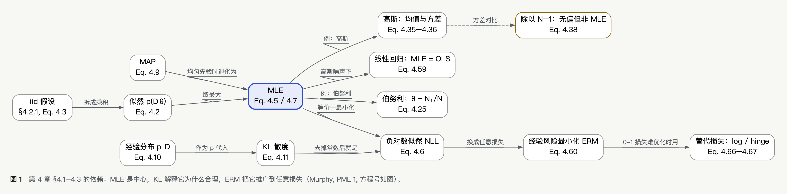
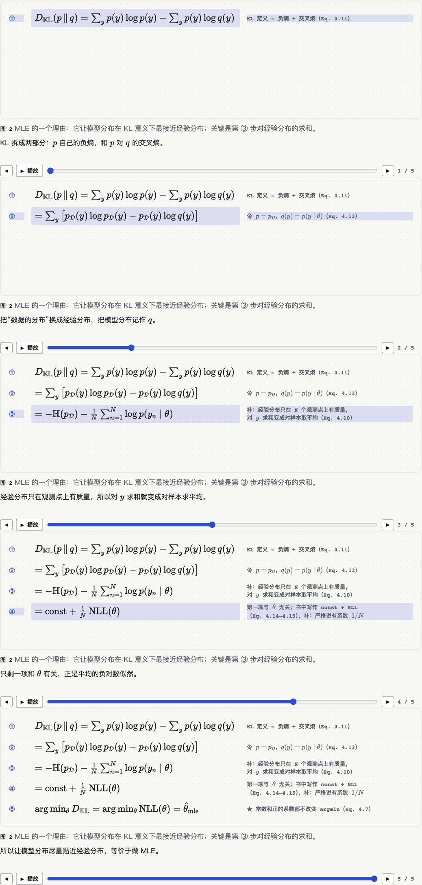

# 第 4 章 统计：MLE 这一条线

## 1. 概念图

读图顺序：从「似然」出发，往下是 MLE 的定义链（iid → 乘积 → 取对数 → NLL），往右是它的两个理由（KL、MAP），再往下是例子（伯努利、高斯、线性回归），最后一般化到 ERM。

## 2. 核心结果

### 结果 A：MLE 等价于让模型分布在 KL 意义下贴近经验分布（§4.2.2，Eq. 4.10–4.15）

- **陈述**：令 $p_{\mathcal D}$ 为经验分布（Eq. 4.10），$q(y)=p(y\mid\theta)$，则 $D_{\rm KL}(p_{\mathcal D}\,\|\,q)=\text{const}+\text{NLL}(\theta)$，所以最小化 KL 与求 MLE 相同。
- **条件**：无条件模型；有监督时换成对 $x$ 取期望的 KL（Eq. 4.16–4.18）。
- **起作用的那一步**：经验分布只在 $N$ 个观测点上有质量，对 $y$ 求和变成对样本取平均（Eq. 4.13 → 4.14）。
- **补**：书中 NLL 的定义（Eq. 4.6）不带 $1/N$，所以 Eq. 4.15 严格说是 $\text{const}+\frac1N\text{NLL}(\theta)$；正的系数不改变 argmin，结论不受影响。
- 分步推导：　交互版：`fig-mle-kl-proof.html`

### 结果 B：高斯 MLE 与它的偏差（§4.2.5 Eq. 4.35–4.38；§4.7.6.1 Eq. 4.233–4.236）

- $\hat\mu_{\rm mle}=\bar y$（Eq. 4.35），无偏（Eq. 4.233）。
- $\hat\sigma^2_{\rm mle}=\frac1N\sum(y_n-\hat\mu)^2$（Eq. 4.36），$\mathbb E[\hat\sigma^2_{\rm mle}]=\frac{N-1}N\sigma^2$（Eq. 4.234），**有偏**，偏小。
- 直觉（书中）：估均值“用掉”了一个数据点；$N=1$ 时方差估计为 0。
- 除以 $N-1$ 得无偏的 $\sigma^2_{\rm unb}$（Eq. 4.38 / 4.235），但它**不是** MLE。
- 已知 $\mu$ 时，MLE 的方差估计是无偏的（书中提到，留作 Exercise 4.8）。

### 结果 C：MLE 达到 Cramér–Rao 下界，渐近最优（§4.7.6.2，正文陈述，证明见书引 [Ric95]）

- **条件**：光滑性等正则条件（书中只说 “various smoothness assumptions”）；**补**：还隐含模型设定正确，即真分布在模型族里。
- 我们没有核对证明，只记陈述。

## 3. 例子与反例

| 概念 | 典型例子（书中） | 反例：为什么需要那个条件 |
|---|---|---|
| MLE | 伯努利 $\hat\theta=N_1/N$（Eq. 4.25） | 抛 3 次全是正面 → $\hat\theta=1$，预测永远不会出反面；这是 §4.5.1 引入 MAP 的动机 |
| MLE 无偏？ | 高斯均值（Eq. 4.233） | 高斯方差（Eq. 4.234）；极端情形 $N=1$ 估计为 0 |
| 无偏就够好？ | $\bar x$ | 只取第一个点 $\hat\theta=x_1$ 也无偏，但方差大得多（§4.7.6.1 正文） |
| MLE = OLS | 高斯噪声下的线性回归（Eq. 4.59） | 补：噪声是拉普拉斯分布时，MLE 变成最小绝对偏差，不再是 OLS |

## 4. 跨章联系

- 需要：§6.1–6.2（熵、交叉熵、KL）；第 8 章（优化，求 argmin 的算法）。
- 后续用到：§4.5 正则化 / MAP（MLE 加先验）；§4.6.7.1（MLE 作为均匀先验下的后验众数）；§11 线性回归。
- 和学习者自己的研究（补，联想）：SDID 的 Eq. 1.1 是加权最小二乘；按本章 Eq. 4.59 的逻辑，若误差是同方差高斯，它就是加权的高斯似然最大化。这是“为什么回归式估计量能写成 MLE”的入口，见 `concepts/method-synthetic-did.md`。

## 5. 原文疑点（待核）

- **Exercise 4.9 的两个 MSE 疑似对调**。书中写 $\text{MSE}(\sigma^2_{\rm unb})=\frac{2N-1}{N^2}\sigma^4$、$\text{MSE}(\sigma^2_{\rm mle})=\frac{2}{N-1}\sigma^4$（PDF p. 196，与 pypdf 抽出的文字一致，不是转写错误）。我们推导：$\sigma^2_{\rm unb}$ 无偏，$\mathbb V[\sigma^2_{\rm unb}]=\frac{\sigma^4}{(N-1)^2}\cdot2(N-1)=\frac{2\sigma^4}{N-1}$，所以 MSE 就是 $\frac{2}{N-1}\sigma^4$；$\sigma^2_{\rm mle}$ 的方差 $\frac{2(N-1)}{N^2}\sigma^4$（Eq. 4.258）加偏差平方 $\frac{\sigma^4}{N^2}$ 得 $\frac{2N-1}{N^2}\sigma^4$。结论：两式的下标应互换。**我们的推导，待核**（可对照书的 errata 或 GitHub issues）。
- 这也说明了一个常被忽略的点：有偏的 MLE 的 MSE 反而更小（$\frac{2N-1}{N^2}<\frac{2}{N-1}$ 对所有 $N\ge2$ 成立），正好接上 §4.7.6.3 的偏差-方差权衡。
