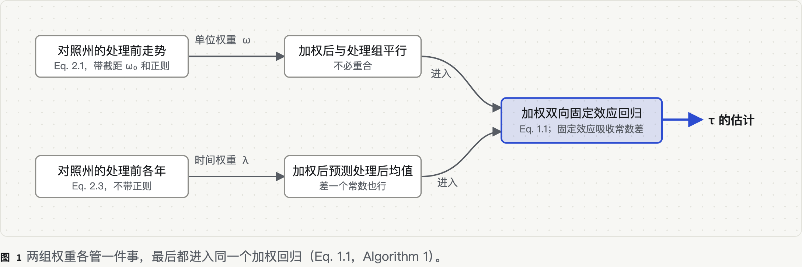
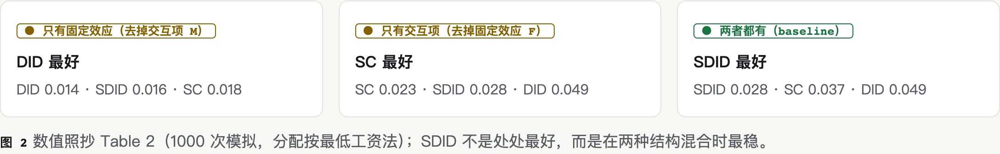
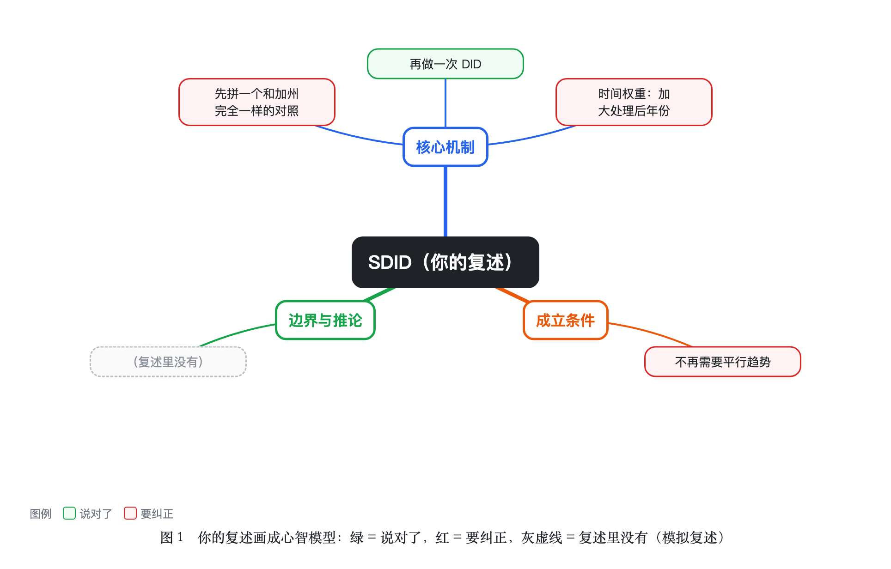
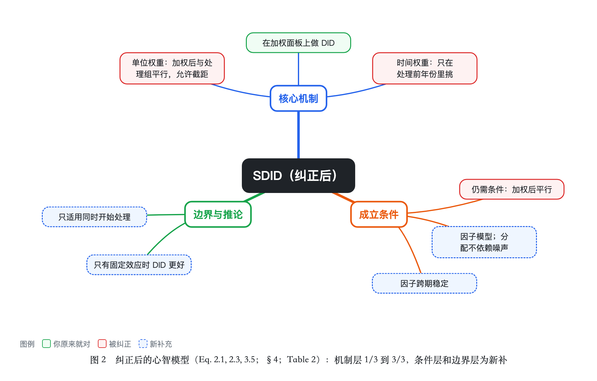

# SDID（2026-10-16）

## 0. 定位
档案里有 `method-difference-in-differences`（能用）和 `method-synthetic-control`（学过但生疏）。讲 SDID 需要两者，SC 记录是“生疏”，所以先问了一题：

> 讲 SDID 要用到合成控制。你对它：A 没学过 B 学过但生疏 C 能用 D 能讲给别人听；在哪学的？

模拟回答：B，Abadie 等人的加州控烟例子。→ 先用两句话复习 SC：用对照州的加权平均拼出“没加税的加州”，权重靠处理前拟合选出。

## 1. 大白话
DID 让所有对照州、所有年份一样重要；SDID 只看和加州走势像的州、和处理后像的年份，然后照常做 DID。

## 2. 动机
加州 1989 年前的吸烟走势和其他州明显不平行，DID 的平行趋势站不住（§2.2，Figure 1 文字说明）；SC 能拼出走势，但没有单位固定效应，要求拼得完全重合。

## 3. 例子 → 一般 → 定义
- 例子：Table 1 五个估计（SDID −15.6，SC −19.6，DID −27.3，MC −20.2，DIFP −11.1）。DID 明显更大，作者认为它高估了（§2.2）。
- 一般：同一个双向固定效应回归，加不同权重就是不同方法（Eq. 1.1–1.3）。
- 定义：Eq. 1.1 与权重 Eq. 2.1、2.3（见 papers/…/method.md）。

## 4. 连接
| 已知概念 | 相同 | 不同 | 类比在哪里失效 |
|---|---|---|---|
| DID | 双向固定效应回归 | SDID 给州和年份加权 | DID 的平行趋势是对全体对照州；SDID 只要求加权后平行 |
| SC | 用处理前拟合选单位权重 | SDID 有截距和正则，还有时间权重和单位固定效应 | SC 要求拼得重合，SDID 只要求平行 |
| 加权回归 / IPW | 都是给样本加权 | 权重来自走势拟合，不是来自倾向得分 | 没有“被处理的概率”这层含义 |

## 5. 图
- 
- 

## 复述与诊断

### 第 1 轮（2026-10-16）
> 复述（模拟）：“SDID 就是先用合成控制把对照州拼得和加州完全一样，再做一次 DID，所以不再需要平行趋势假设了；时间权重是为了给处理后的年份更大的权重。我联想到 event study 里看处理后各期。”

- 分层：机制 1/3；条件 0/3（且有一条误解）；边界 0/2
- ✅ “再做一次 DID”（对应 §2.2：对重新加权的面板做 DID 分析；Eq. 1.1）
- 🟡 “拼得和加州完全一样”：只需平行，截距 ω₀ 允许常数差（Eq. 2.1）。反例：加州处理前人均消费整体比对照高一截但走势相同，SC 要拼重合会被迫找极端权重，SDID 用 ω₀ 吸收这一截即可。
- ❌ “不再需要平行趋势”（层级：心智模型缺陷）：SDID 把平行趋势换成“加权后平行”，并依赖因子模型、分配不依赖噪声等条件（Eq. 3.5，§4）。反例（示意，非原文）：如果 1989 年加州同时启动一项只在加州的反吸烟宣传，任何对照州的加权都拼不出这一冲击，SDID 照样有偏。
- ❌ “时间权重给处理后年份更大权重”（层级：孤立错误信念）：处理后各年权重被约束为 $1/T_{\rm post}$，时间权重只在处理前年份里分配（Eq. 2.3 的 Λ）。
- 🔗 “联想到 event study”：好联想。event study 常把最后一个处理前时期当对照，等于把全部权重放在它上面；SDID 让数据决定处理前各年的权重（§2.2）。这条边画进了纠正后的图。
- 纠正后的图： → 

纠正顺序（从你的联想出发）：先接住“event study”——问“event study 里处理前哪一期最重要？”（模拟回答：最后一期）→ 指出 SDID 的时间权重就是在处理前各期里重新分这份“重要性”，处理后各期是等权的 → 再给加州同期宣传的反例，问“哪个对照州的加权能模仿这件事？”（模拟回答：没有）→ 由此引出“平行趋势没被取消，只是换成了加权后的条件”。

### 第 2 轮（2026-10-16）
> 复述（模拟）：“SDID 给对照州加权，让它们和加州的走势平行，差一个常数没关系；时间权重只在加税前的年份里挑能代表加税后的那些年。它还是要假设：没有只冲击加州的同期事件，因子结构稳定。DID 在只有固定效应的时候其实更好。”

- 分层：机制 3/3；条件 2/3；边界 1/2
- ✅ 平行而非重合；✅ 时间权重只在处理前；✅ 同期冲击条件（§4）；✅ “只有固定效应时 DID 更好”（Table 2，No M 行：DID 0.014，SDID 0.016）
- 🟡 未提分配可以依赖系统成分 L 但不能依赖噪声（Eq. 3.5）——这是 SDID 能处理非随机分配的关键，补一句。
- 🟡 未提 block assignment 的限制（Eq. 4.2）。
- 无 ❌，本概念本轮结束。

## 留下的问题
- [x] §5 的 placebo 标准误怎么构造？为什么 $N_{\rm tr}=1$ 时还能用？→ Algorithm 4：从对照组抽 $N_{\rm tr}$ 个单位当“安慰剂处理组”，重复 B 次，取估计值的方差。能用的代价是假设单位间同方差；作者说只有一个处理单位时，这个假设实际上是做推断的必要条件（§5）。
- [ ] 第 4 节定理的条件里“signal to noise”具体怎么量化？
